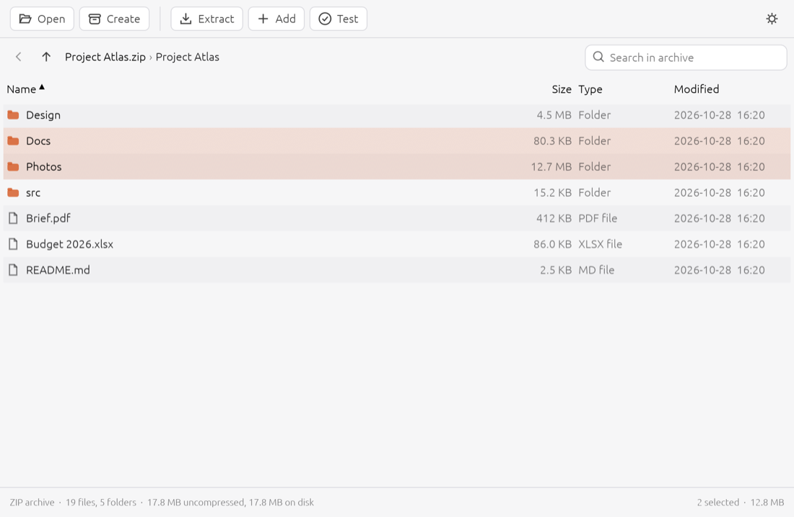
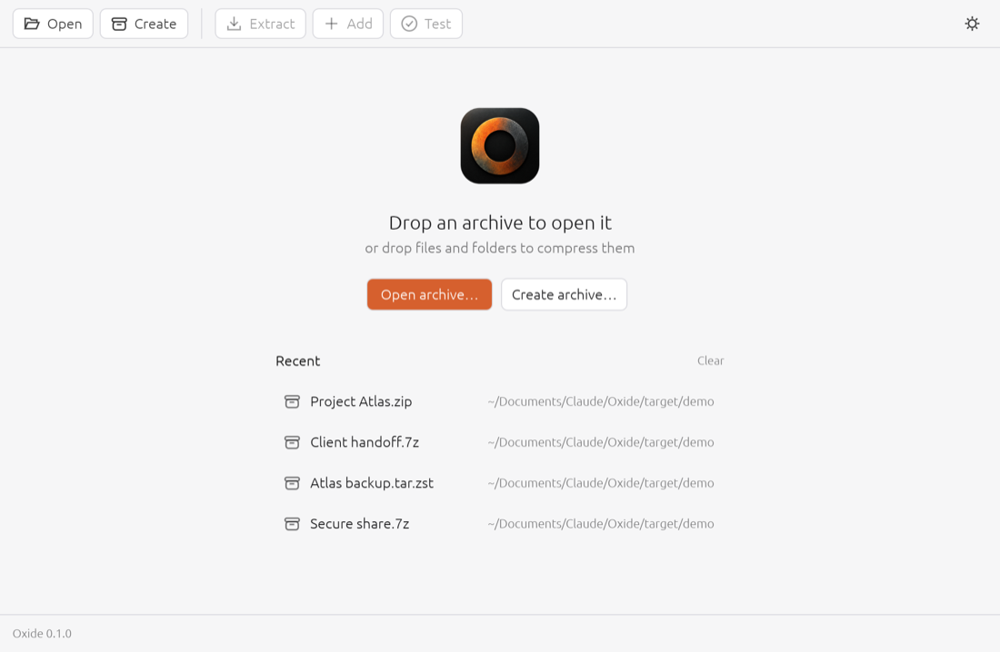
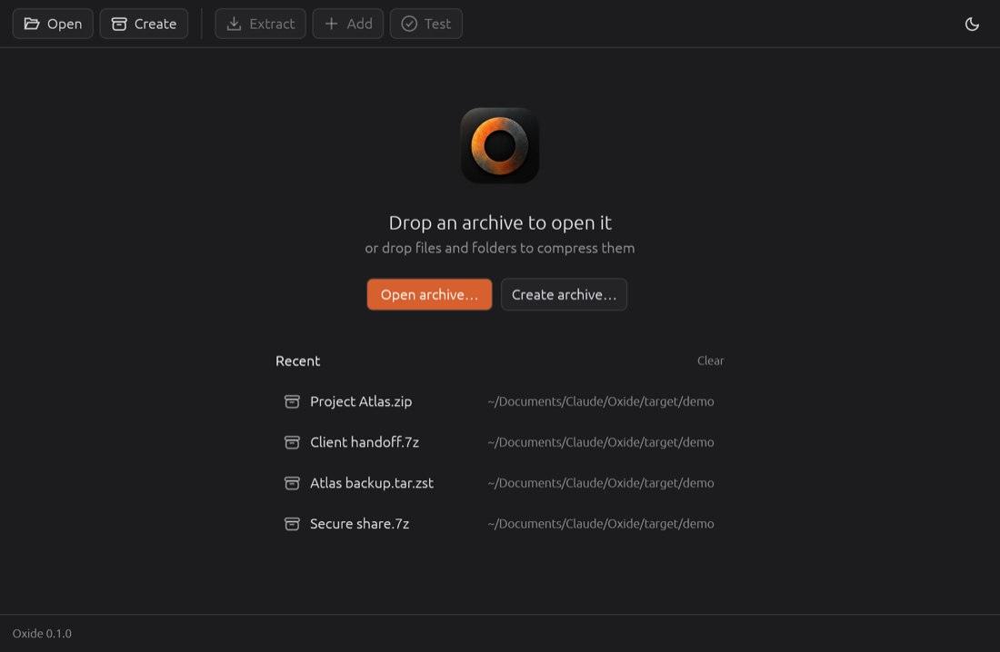
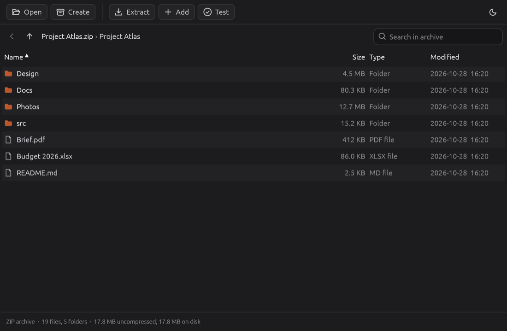
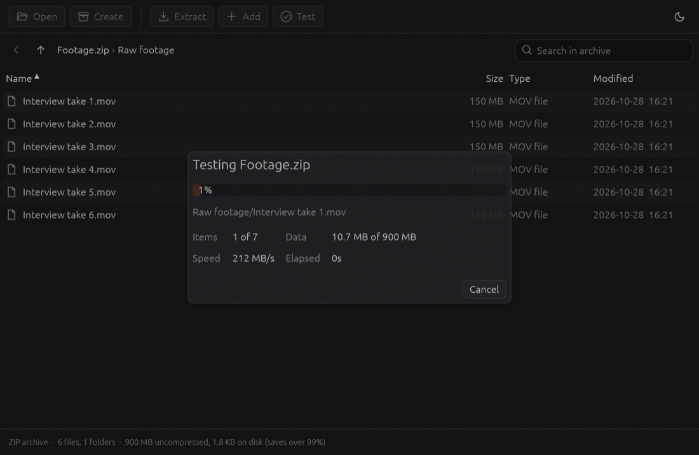
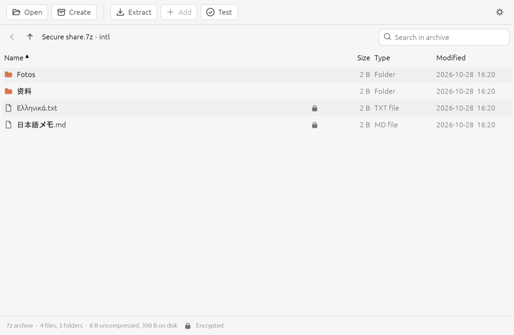

# Oxide

A fast, safe, open-source archive manager for macOS, Linux and Windows, written in Rust.
Oxide has a native desktop app and a scriptable command-line tool, both built on the same
archive engine (`oxide-core`), which you can also embed in your own programs.



- **Formats:** ZIP, 7z, TAR, TAR.GZ, TAR.XZ, TAR.ZST, TAR.BZ2, GZIP, BZIP2, XZ, ZSTD, plus RAR
  extraction (see [the format matrix](docs/FORMATS.md)).
- **Safe by default:** treats every archive as hostile. Blocks Zip Slip and absolute paths,
  confines symlinks and hard links, never writes through existing links, enforces size, count
  and ratio limits against decompression bombs, and never overwrites files silently.
- **Never half-written:** archives and extracted files are written to temporary files and moved
  into place only when complete. Cancelling or failing leaves nothing behind.
- **Streaming:** archives are never loaded into memory. Large files and Zip64 (> 4 GiB entries)
  are supported. Zstandard, XZ and 7z/LZMA2 compression can use all CPU cores.
- **Encryption:** AES-256/AES-128 ZIP and AES-256 7z, including encrypted 7z headers. Passwords
  are zeroed from memory after use and never logged.
- **No telemetry, no network access, no external programs.** It is pure Rust apart from the
  zstd, xz, bzip2 and (optional) UnRAR C libraries, which are compiled in.

## Install

### Download

Tagged releases publish these via [`.github/workflows/release.yml`](.github/workflows/release.yml):

| Platform              | Files                                                        |
|-----------------------|--------------------------------------------------------------|
| macOS (Apple Silicon, Intel) | `Oxide-<ver>-macos-*.dmg` (app bundle), `oxide-cli-*.tar.gz` |
| Windows x64           | `Oxide-<ver>-windows-x64-setup.exe` (installer, optional file associations), portable `.zip` |
| Linux x86_64 / ARM64  | `Oxide-<ver>-<arch>.AppImage`, `oxide-<ver>-linux-*.tar.gz`  |

The macOS app is ad-hoc signed but not notarized. On first launch, right-click it and choose
**Open**.

### From source

You need Rust **1.95 or newer** (`rustup update stable`).

```bash
git clone https://github.com/zenfy-dev/oxide && cd oxide
cargo build --release
```

This produces `target/release/oxide` (CLI) and `target/release/oxide-gui` (desktop app).
Add `--features oxide-core/rar` to include RAR extraction (see [Licensing](#licensing)).

Linux needs a few development headers for the GUI:

```bash
sudo apt-get install libxkbcommon-dev libwayland-dev libx11-dev libxcb-render0-dev libxcb-shape0-dev libxcb-xfixes0-dev
```

The GUI uses the desktop portal (`xdg-desktop-portal`) for file dialogs, which GNOME, KDE and
most modern desktops provide.

## Command line

```bash
oxide create documents/ -o backup.zip          # format from the extension
oxide create project/ -o project.tar.zst -l 19 # compression level
oxide create photos/ -o photos.7z -p secret    # AES-256, encrypted headers
oxide extract backup.zip -o ./output/
oxide extract backup.zip --only docs/ --overwrite rename
oxide extract project.zip -o ./project/ --strip-components 1 # remove a wrapper folder
oxide list backup.zip
oxide test backup.zip                          # verify checksums
oxide add backup.zip notes.txt                 # ZIP and TAR family
oxide formats                                  # what this build supports
oxide --help                                   # and `oxide <command> --help`
```

| Option | Applies to | Meaning |
|---|---|---|
| `-l, --level N` | create, add | Compression level (range per method; see `oxide formats`) |
| `-m, --method M` | create, add | `deflate`, `store`, `bzip2`, `zstd`, `xz` (ZIP), `lzma2` (7z) |
| `-p, --password` / `--password-env VAR` | all | Password. Prefer `--password-env` on shared machines. |
| `--encryption aes256\|aes128` | create, add | ZIP encryption strength |
| `-t, --threads N` | create, add | Compression threads (0 = all cores) |
| `--flatten`, `--exclude-hidden`, `--follow-symlinks` | create, add | Input handling |
| `--force` | create | Replace an existing output file |
| `--overwrite error\|skip\|overwrite\|rename` | extract | Existing files (default: `error`) |
| `--strip-components N` | extract | Remove N leading path components; shorter paths are skipped. `--only` matches original paths. |
| `--max-size 64G`, `--max-entries N`, `--max-ratio N`, `--no-limits` | extract | Bomb protection |
| `--no-symlinks`, `--no-preserve` | extract | Skip links / permissions and times |
| `--json` | all | Machine-readable output on stdout, including errors |
| `-q`, `-v`, `--no-progress` | all | Quiet, verbose (`-vv` for debug), no progress bar |

The CLI never prompts, so it is safe in scripts. Progress bars appear only on a terminal.
Ctrl+C cancels cleanly (temporary files are removed). Pressing it again exits immediately.

**Exit codes:** `0` success, `1` error, `2` invalid usage, `3` corrupt archive,
`4` password missing or wrong, `5` unsafe entry or limit exceeded, `6` destination exists,
`130` cancelled.

## Desktop app

**On macOS, double-clicking an archive in Finder (or Open With → Oxide) extracts it without
opening a window,** like Archive Utility. A single top-level item is placed next to the archive;
several items go into a folder named after it. Existing names are never replaced ("Photos 2").
The window only appears if the archive needs a password or can't be extracted. Open Oxide itself
(Dock, Launchpad, Spotlight) to browse archives.

Run `oxide-gui`, optionally with an archive path, to open it in the window. The start screen
lists recently opened archives (click one to reopen it), and you can drop an archive or a pile of
files anywhere on the window.

| Start screen (light) | Start screen (dark) |
|---|---|
|  |  |

You can:

- **Open** an archive (⌘/Ctrl+O, drag-and-drop, the recent list, or Finder's Open With) and
  browse it like a folder. Use breadcrumbs, back/up (Backspace), and double-click to enter folders.
- **Move** through the list with the arrow keys; Enter opens the selected folder.
- **Sort** by any column and **search** across the whole archive (⌘/Ctrl+F). Search is
  case-insensitive; separate words to match each anywhere in the path (for example `src .rs`).
- **Select** with click, ⌘/Ctrl-click and Shift-click, or select all with ⌘/Ctrl+A. Right-click
  for "Extract selected".
- **Extract** (⌘/Ctrl+E) everything or just the selection, into a new folder, choosing what
  happens to existing files. Set **Remove leading folders** to 1 to discard a wrapper folder.
- **Create** (⌘/Ctrl+N) by choosing format, method, level, password and encryption, with or
  without folder structure and hidden files.
- **Add** (⌘/Ctrl+Shift+A) files to ZIP/TAR archives, or drop files onto an open archive.
- **Test** (⌘/Ctrl+T) integrity.

Work runs on a background thread. The window stays responsive and shows the current file, items
and bytes processed, percentage, speed, elapsed time, and an ETA, with a Cancel button.

The app follows the OS light/dark setting; the button at the top right switches between system,
light and dark. Your theme choice, window size and recent archives are remembered between
launches. Encrypted entries show a lock, the status bar summarises size and compression, and
non-Latin filenames render using system fonts.

| Dark theme | Progress |
|---|---|
|  |  |
| **Encrypted 7z with Greek, Chinese and Japanese names** | |
|  | |

## Library

```rust
use std::path::{Path, PathBuf};
use oxide_core::{CreateOptions, ExtractOptions, OverwritePolicy, Progress};

let progress = Progress::with_callback(|u| eprintln!("{:?} {:.0}%", u.current, u.fraction.unwrap_or(0.0) * 100.0));
oxide_core::create(&[PathBuf::from("docs")], Path::new("docs.tar.zst"), &CreateOptions::default(), &progress)?;

let info = oxide_core::list(Path::new("docs.tar.zst"), &Default::default())?;
println!("{} files, ratio {:?}", info.file_count(), info.compression_ratio());

let opts = ExtractOptions { overwrite: OverwritePolicy::Rename, ..Default::default() };
oxide_core::extract(Path::new("docs.tar.zst"), Path::new("out"), &opts, &progress)?;
```

Cancellation: `progress.cancel_token().clone()` can be cancelled from any thread. See
[docs/ARCHITECTURE.md](docs/ARCHITECTURE.md) for the design and how to add a format.

## Security model

Extraction treats archives as untrusted:

| Threat | Defence |
|---|---|
| `../` traversal (Zip Slip) | Any `..` component aborts the extraction |
| Absolute paths, `C:\`, UNC | Prefix removed and the path re-rooted in the destination (with a warning) |
| Symlink escapes | Links are created last, only if their target stays inside the destination. Chains are re-checked after creation. |
| Writing through links | Every existing path component is checked; Oxide never writes through a symlink, including ones already in the destination |
| Hard links | Target must be a regular file already extracted inside the destination |
| Decompression bombs | Sizes are counted as data is decoded (declared sizes aren't trusted). Default limits: 64 GiB total, 1M entries, 1000:1 ratio after 64 MiB. All are configurable. |
| setuid/setgid bits | Always stripped |
| Overwrites | Refused by default. Optional skip, rename or overwrite. |
| Partial output | Each file is written to a temp file and renamed only when complete and verified |
| Windows-reserved names | `CON`, `NUL`, `a:b`, trailing dots and similar are made safe |

## Limitations

- **RAR:** extraction only, via RARLAB's UnRAR (opt-in feature). Multi-volume RAR sets are not
  supported. UnRAR can only extract to files, so each RAR entry is staged in a temporary
  directory before going through the normal safety checks.
- **7z:** adding to an existing 7z is not supported. Creation uses solid LZMA2 blocks of up to
  256 MiB. Symlinks are stored using the p7zip Unix-attribute convention.
- **ZIP:** Oxide writes AES encryption only. Legacy ZipCrypto can be read but not written,
  because it is broken. ZIP timestamps are stored in local time, as the format requires.
- **ZIP/TAR edits** (`add`) rewrite the archive to a temporary file. ZIP entries are copied
  without recompression. TAR entries are re-streamed, and PAX extended attributes are not
  preserved.
- **TAR** writes owner IDs as 0 (no account names), and does not store extended attributes or
  ACLs.
- **Single-file formats** (`.gz`, `.xz`, ...) name the output after the archive, and ignore any
  name stored inside gzip headers.
- **Linux AppImage/ARM64** and the **Windows installer** are produced by CI but have not been
  hand-tested yet (see below).

## Development

```bash
cargo fmt --all
cargo clippy --workspace --all-targets --features oxide-core/rar -- -D warnings
cargo test --workspace --features oxide-core/rar
cargo test --release -p oxide-core -- --ignored   # 4 GiB Zip64 test
python3 tools/benchmark_archiver.py               # release CLI listing/filter benchmark
```

The benchmark uses a temporary 50,000-entry ZIP and 1,000 unmatched extraction selections.
To compare changes, save an older release binary and pass `--baseline /path/to/old/oxide`;
the report gives medians from seven measured runs after warming both binaries. Selection
filtering deliberately writes no files, so it measures index and path-matching overhead.

### Verification status

| What | macOS 26 (Apple Silicon) | Linux | Windows |
|---|---|---|---|
| Unit, integration and CLI tests (64) | ✅ pass | CI configured, not yet run | CI configured, not yet run |
| `clippy -D warnings`, `rustfmt` | ✅ | CI | CI |
| Zip64 > 4 GiB | ✅ | — | — |
| Interop with Info-ZIP, bsdtar/libarchive, gzip/xz/bzip2/zstd | ✅ ([details](docs/FORMATS.md)) | — | — |
| GUI rendering in light/dark, dialogs, progress, password flow | ✅ (screenshots) | not yet checked | not yet checked |
| Symlink/permission tests | ✅ (Unix-only tests) | — | Windows symlinks need Developer Mode, otherwise they're skipped with a warning |
| Release packaging (DMG, AppImage, installer) | Workflow written, not yet run | Workflow written, not yet run | Workflow written, not yet run |

## Licensing

Oxide is dual-licensed under [MIT](LICENSE-MIT) or [Apache-2.0](LICENSE-APACHE).

The optional `rar` feature compiles RARLAB's UnRAR source, which is freeware but **not**
OSI-approved open source. Redistribution is permitted, but the code may not be used to create
RAR archives. Release binaries include it, and ship [its licence](licenses/UnRAR-license.txt).
Builds without the feature contain no UnRAR code.
